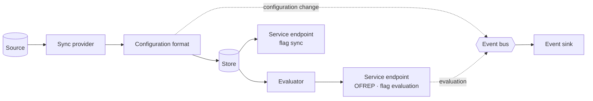

# OpenFeature Relay

**Build the flag relay you need, from components — with flagd as the reference implementation.**

> [!IMPORTANT]
> This is an independent **proof of concept**, incubated by a flagd maintainer.
> It is **not** an official OpenFeature or CNCF project, and nothing here is endorsed by the OpenFeature Technical Committee.
> If the idea holds up, the pieces are shaped so they can be proposed to [open-feature/flagd](https://github.com/open-feature/flagd) later.
> Until then there are no releases and no images; build from source.

## What is it?

A **flag relay** is a process that syncs flag configurations from somewhere, keeps them, evaluates them and serves them to OpenFeature clients — over [OFREP](https://github.com/open-feature/protocol), flagd's flag evaluation API, flag sync for in-process providers, or something else.
[flagd](https://flagd.dev) is one. So are a vendor's edge proxy and relay proxy.

OpenFeature Relay is a **runtime and a builder** for flag relays, in the way the [OpenTelemetry Collector Builder](https://opentelemetry.io/docs/collector/custom-collector/) is for collectors:

- you list the components you want in a **manifest**,
- the **builder** generates and compiles a **distribution** that contains exactly those components,
- anyone can write a component in their own Go module and build it in, without forking.

flagd is the reference implementation, and the code starts from flagd's (this repository carries flagd's full history).
Today's flagd becomes the **flagd-full** distribution: same CLI, configuration, ports, endpoints and behaviour.

## Why?

flagd today ships as one binary with every sync provider (file, HTTP, gRPC, Kubernetes, GCS, Azure Blob, S3), every service endpoint and the full OpenTelemetry SDK.

- Its `core` module pulls in roughly 700 transitive dependencies, whatever you actually use.
- Adding a sync provider or an endpoint means changing flagd itself.
- In-process providers embed flagd's evaluator and, until recently, got its tracing spans whether they wanted them or not.
- A vendor that wants OFREP, flag sync, event streams and telemetry for its own flag engine has to build all of it again.

OpenFeature Relay keeps the parts that every relay needs — polling, the store, change events, OFREP with its event stream, flag sync, telemetry, event delivery — shared, and makes everything else a selectable component.

## Concepts



| Component type | What it does | flagd-full ships |
|----------------|--------------|------------------|
| Sync provider | Reads flag configurations from a kind of source | file, HTTP, gRPC, Kubernetes, GCS, Azure Blob, S3 |
| Configuration format | Validates flag configurations of one format and keeps them in the store as documents | flagd's JSON schema |
| Evaluator | Resolves flags for an evaluation context from its paired format's documents; emits no telemetry | flagd's JsonLogic evaluator |
| Service endpoint | Serves flags to clients over a protocol | flag evaluation (gRPC/Connect), OFREP, flag sync |
| Middleware | Wraps an endpoint's HTTP handler (auth, CORS, rate limits) | h2c, CORS, HTTP metrics |
| Telemetry provider | Tracing and metrics for endpoints and middleware | OpenTelemetry |
| Event sink | Delivers configuration change, evaluation and tracking events elsewhere | — (new) |

A configuration format and its evaluator can ship together as an **engine module** — that is how vendors ship their engines.
Each format keeps its own documents in the store, so flagd's flag model stays unchanged while a vendor's stays the vendor's.
All terms are defined in the [glossary](docs/glossary.md).

## Distributions

| Distribution | Contents | Purpose |
|--------------|----------|---------|
| **flagd-full** | every official component | today's flagd, unchanged |
| **flagd-sync** | sync providers, flagd's format, flag sync — no evaluator | a configuration proxy: in-process providers get validated flag configurations from one place |
| flagd-minimal, flagd-cloud, flagd-kubernetes | subsets | smaller binaries without the SDKs you don't use |
| **vendor distribution** | a vendor's sync provider and engine behind OFREP | e.g. the Flagsmith engine or GO Feature Flag's, serving OpenFeature clients in place of the vendor's edge proxy |
| your own | whatever your manifest lists | custom sources, endpoints, sinks |

## Status

Proof of concept. The specification is complete enough to build against; the code is at the start.

| | |
|---|---|
| **Done** | The evaluator no longer imports OpenTelemetry, gRPC, Kubernetes or cloud SDKs, enforced by `depguard` rules and a CI boundary check; `golang.org/x/exp` replaced by the standard library. |
| **In progress** | Splitting the configuration format out of the evaluator, with document versions ([UC-018](docs/use_cases/UC-018-develop-configuration-format-extension.md)). |
| **Next** | Dependency-free evaluator and format modules for in-process providers; the untyped bulk evaluator and evaluation router; sync, service and other factories with the event bus; contract tests; the module split, builder CLI and manifest; flagd-full built by the builder passing the flagd test harness; a Flagsmith engine module as the cross-vendor proof. |

What you can run today is flagd-full — that is, flagd built from this tree.
The full order is in [CLAUDE.md](CLAUDE.md#poc-one-use-case-after-the-other); each use case's `Status` line in [docs/use_cases/](docs/use_cases/) says where it stands.

## Try it

You need Go (the version in `flagd/go.mod`), `make` and `curl`.

```sh
git clone https://github.com/open-feature-forking/openfeature-relay.git
cd openfeature-relay
git submodule update --init
make workspace-init
make build-flagd
./bin/flagd start --uri file:./config/samples/example_flags.flagd.json
```

Evaluate a flag over flagd's evaluation API (port 8013):

```sh
curl -X POST "http://localhost:8013/flagd.evaluation.v1.Service/ResolveBoolean" \
  -H "Content-Type: application/json" -d '{"flagKey":"myBoolFlag","context":{}}'
```

…or over OFREP (port 8016):

```sh
curl -X POST "http://localhost:8016/ofrep/v1/evaluate/flags/myBoolFlag" \
  -H "Content-Type: application/json" -d '{"context":{}}'
```

Run the tests with `make test`.
On Windows, use WSL for Go and Docker.

## flagd

Everything flagd does, flagd-full does.
flagd's documentation lives in [docs/](docs/index.md) in this repository and, for released flagd, at [flagd.dev](https://flagd.dev).
flagd itself is developed at [open-feature/flagd](https://github.com/open-feature/flagd) by [its contributors](https://github.com/open-feature/flagd/graphs/contributors); this repository merges upstream regularly.
For production use, use [released flagd](https://flagd.dev/installation/), not this repository.

## How it's built

The specification is the contract, written with the AI Unified Process:
[vision](docs/vision.md), [requirements](docs/requirements.md), [glossary](docs/glossary.md), [use cases](docs/use_cases/) and [research](docs/research/cross-vendor-evaluation.md).

The code is written by AI agents in a fixed loop, with a human approving each plan and able to stop any pull request:

| Role | Does |
|------|------|
| planner | turns a use case into steps, characterization tests and gates |
| opposer | attacks the plan before code is written |
| implementer / mechanic | implements the approved steps, with the gate output |
| reviewer | re-runs the gates and reviews the pull request |

Agent definitions are in [.claude/agents/](.claude/agents/), plans and their reviews in [.claude/plans/](.claude/plans/), the working agreement in [CLAUDE.md](CLAUDE.md).
Every slice lands as a pull request in this repository, and flagd's own gates — unit tests, lint, benchmarks, the test-harness acceptance suites — have to stay green.

## Contributing

Ideas, questions and criticism of the approach are the most useful contribution right now: open an issue.
For code, read [CONTRIBUTING.md](CONTRIBUTING.md); commits need a DCO sign-off.

## License

[Apache License 2.0](LICENSE), as flagd.
