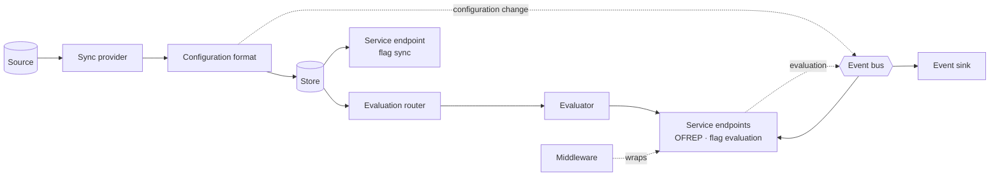

# Architecture

This is the target design. Today's code is flagd's, part way there; see [Status and roadmap](status.md).

The **runtime** is the part of a distribution that starts the sync providers, hands their flag configurations to configuration formats, publishes events on the event bus and starts the service endpoints.

1. A **sync provider** reads a source. A fetching sync provider only fetches on request; the core's poller schedules it, sends conditional requests and refetches on a trigger.
2. The core decodes the **encoding** (JSON or YAML) and hands the result to the source's **configuration format**, which validates it and writes documents to the **store**. A rejected configuration leaves the store unchanged.
3. On a change, the runtime publishes a **configuration change event** on the **event bus**.
4. A client request reaches a **service endpoint**, through its middleware. For evaluation, the **evaluation router** picks, for the selector and flag key, the configuration format holding the flag and its evaluator; the **evaluator** returns untyped results, and type checks stay in the core.
5. The flag sync endpoint and the OFREP event stream watch the store; **event sinks** subscribe to the event bus.

The evaluator emits no telemetry: in-process providers get their observability from OpenFeature hooks, and flagd-full's service endpoints record the evaluation spans.

The rules behind each step are in the use cases, for example [UC-018 Develop Configuration Format Extension](../use_cases/UC-018-develop-configuration-format-extension.md) and [UC-004 Develop Service Endpoint Extension](../use_cases/UC-004-develop-service-endpoint-extension.md).
flagd's own deployment patterns (RPC and in-process evaluation, flagd-proxy) are described in [flagd's architecture](../architecture.md).
